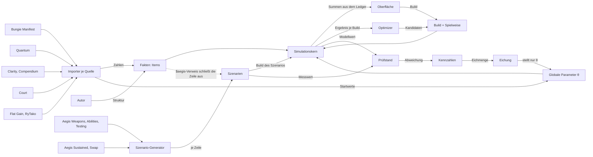
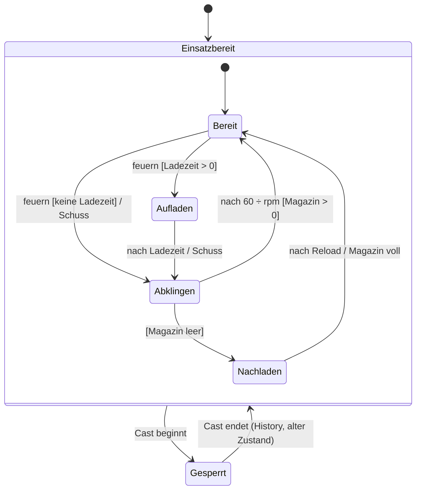
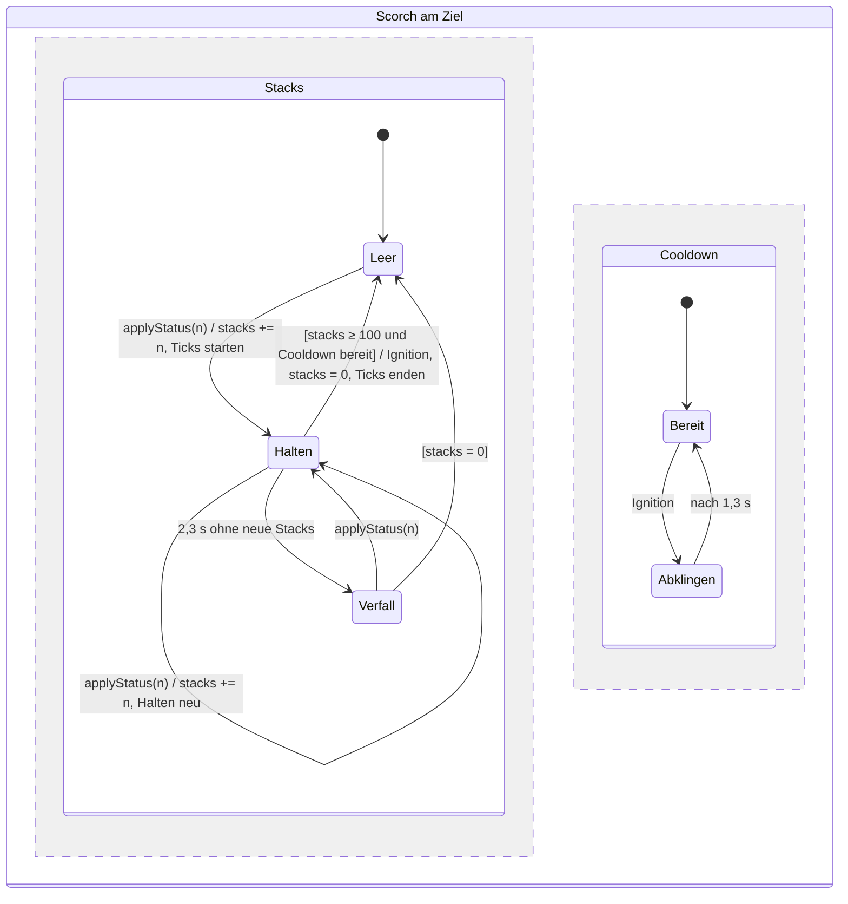
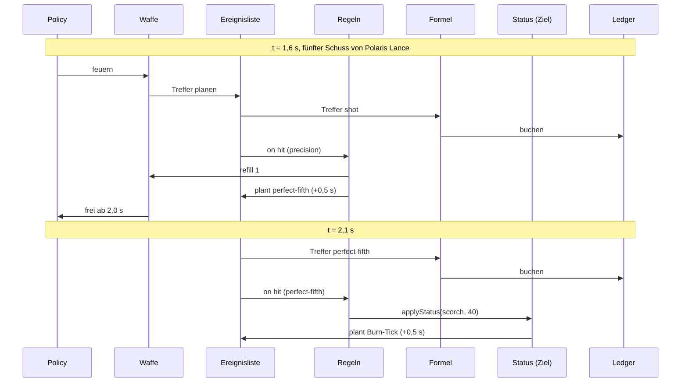
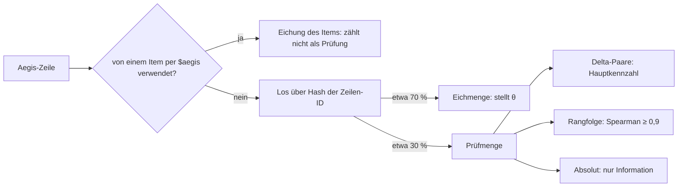

# Bauplan des Rechners

Status: angenommen vom Inhaber am 2026-10-31 (ADR 0018), Quellen der Waffen nach ADR 0019 (Plan Q, vorgeschlagen 2026-11-03) · Umsetzung auf Branch `ground-up-model`, Stufen in `docs/plans/ground-up-model.md` · Ansicht mit zwölf Abbildungen: <https://claude.ai/artifact/2pmKihDrFaJvRdtDwJzBR8>

Diese Datei ist die maßgebliche, maschinenlesbare Fassung; die Ansicht folgt ihr. Lesen vor jedem Block an Engine, Daten, Import oder Prüfstand. Abschnitte tragen die Nummer der Abbildung in der Ansicht (Abb. n).

## 1 Invarianten

Jede Invariante bekommt einen Test in der Stufe, die sie einführt. Bis dahin gilt sie als Regel für neue Arbeit.

| Nr. | Invariante | Stufe, Test |
| --- | --- | --- |
| I1 | **Messung ist Prüfung, nicht Eingang.** Werte aus Aegis Weapons, Abilities oder Testing kommen nur als Verweis `$aegis[<Zeile>]` ins Modell und bekommen den Status `fitted`. Jede verwiesene Zeile zählt nicht mehr als Prüfung. | B2 (Status, Prüfstand), B4 (Resolver) |
| I2 | **Ein Weg.** Oberfläche, Optimizer und Prüfstand rufen denselben Kern über `buildSimulation(build, gameData)`; es gibt keinen zweiten Simulator. | B1 |
| I3 | **Kein Code pro Item.** Neuer Code entsteht nur für einen neuen Auslöser-, Aktions- oder Status-Typ. | B3 (Liste der Typen im Schema) |
| I4 | **Item = Datei.** Die Struktur (Takt, Teile, Regeln) steht von Hand in der Datei; jede Zahl ist ein `$`-Verweis auf eine Quelle oder ein Wert mit `source`. | B4 |
| I5 | **Text-Hash.** Jedes Item merkt sich den Hash seines Quelltexts. Ändert ein Patch den Text, bekommt das Item den Status `review` und rechnet mit der alten Struktur weiter. | B4 |
| I6 | **Kanonische Skala.** Ein Teil trägt den Schaden je Treffer gegen einen generischen Boss ohne Buffs, auf der Skala „Aegis visual“ (Wipe ÷ Full Modifiers). Jede Quelle hat je Kategorie einen Umrechnungsfaktor in θ. | B4, B5 |
| I7 | **Nichts vorab planen.** Neue Ereignisse entstehen nur an drei Stellen: im Fall `shot` (Treffer der Teile), in den Aktionen der Regeln und in der Policy. | B3 |
| I8 | **Ledger.** Jeder Treffer wird mit Zeit, Item, Teil, Grundwert und dem Faktor jedes Buckets gebucht. Summen, Donut, Breakdown, Zeitleiste und Prüfstand sind Projektionen des Ledgers. | B1 (Bestand), B3 |
| I9 | **Eichung stellt nur θ.** Ein Skript passt die globalen Parameter gegen die Eichmenge an. Ein Item wird nie an eine Zeile angepasst; seine Abweichung ist ein Befund. Abweichungen unter 2 % liegen in der Totzone und kommen nach `docs/known-inaccuracies.md`. | B5 |
| I10 | **Festes Los.** Jede nicht verwiesene Zeile fällt über einen Hash ihrer Zeilen-ID in die Eichmenge (etwa 70 %) oder die Prüfmenge (etwa 30 %). Kennzahlen kommen nur aus der Prüfmenge. | B2 |
| I11 | **Hauptkennzahl sind Delta-Paare:** zwei Zeilen, die sich in genau einem Item unterscheiden. Rangfolge (Spearman) ist zweite Kennzahl, Absolutwerte sind nur Information. | B2 |
| I12 | **Determinismus.** Gleiche Eingaben ergeben dieselbe Ereignisfolge; Gleichstände ordnet die Ereignisgruppe, dann die Reihenfolge des Planens. | B1 (Bestand) |

## 2 Datenfluss (Abb. 1)



Es gibt genau eine Rückkopplung: Kennzahlen → Eichung → θ. Keine Kante führt vom Prüfstand zu einem Item.

## 3 Was sich gegenüber heute ändert (Abb. 2)

| Heute | Ziel | Stufe |
| --- | --- | --- |
| Aegis-Zeile ist Eingang (Paket, Mittel je Schuss) und Prüfung zugleich | Aegis-Zeile ist nur Prüfung; Ausnahme `$aegis`-Verweis, dann zählt die Zeile nicht | B2, B4 |
| Annahmen der Zeile werden herausgerechnet (`fullModifiers`, `includedFactor`, Replay) | Annahmen stehen im Szenario; das Modell rechnet sie wie jeden Build | B2, Migration |
| Zwei Simulatoren (`simulate`, `simulateCore`), Parität per Test | ein Kern | B1 |
| Sonderfelder (`hitStacks`, `setup`, `holdDraw`, `refillsMagazine`, `everyNthShot`, `nthShotPart`, `playstyleParts`, `tickFactors`, `catalystWindowSeconds`, `scorchStacksPerShot`, `noReloads`) | Regeln aus etwa zehn Aktionen | B3 (erledigt 2026-11-01; `ImportPart` trägt `requiresCatalyst`, `everyNthShot`, `tickFactors` nur als Importfelder) |
| Struktur aus Text geraten (Regelketten 1–7, F, G, H, R1–R5) plus 65 Overrides | Struktur von Hand in der Item-Datei, Zahlen per Verweis | B4, Migration |
| Skala je Fall (ADR 0011) | kanonische Skala, ein Faktor je Quelle und Kategorie | B4, B5 |
| Globale Parameter von Hand an einzelnen Zeilen gestellt | Eichung per Skript über alle Szenarien | B5 |
| Kennzahl: Szenarien innerhalb ±3 % | Delta-Paare der Prüfmenge | B2 |
| Waffenzahlen je Feld aus Quantum oder `$aegis` (B4), Pakete und Overrides für die übrigen Exotics | Zahlen nur aus Quantum, Mechanik nur aus Clarity (ADR 0019); kein neuer `$aegis`-Verweis | Plan Q |
| Item-Dateien einzeln von Hand (B6: zwei bis drei je Block) | Gerüst je Exotic per Skript (Basiszeile), Mechanik von Hand nach Regelvorlage (5.2), Rest in `notModelled` | Q1, M1–M5 |
| Prüfstand als Gate | bis zur Gegenprobe nur Bericht (Abschnitt 12) | Plan Q |

## 4 Schichten und Abhängigkeiten (Abb. 3)

| Schicht | Aufgabe | liest | darf rufen |
| --- | --- | --- | --- |
| Policy | wählt die nächste Aktion: schießen, nachladen, casten | Spielweisen | Akteure |
| Akteure | Zustandsmaschinen von Waffe und Ability: Magazin, Reload, Charge, Energie | Items: Takt, Teile | Regeln |
| Regeln | Auslöser → Bedingung → Aktionen | Items: Regeln | Status |
| Status | Stacks, Dauer, Verfall, Ticks, Schwelle, Cooldown | Status-Definitionen, θ | Formel |
| Formel | Teil × Precision × Π Buckets × Stat | Buckets | – |

- Abhängigkeiten zeigen nur nach unten und von außen nach innen.
- Außen: Importer (`scripts/`) schreiben nur Zahlen in `src/data`; Treiber (Oberfläche `src/ui`, Optimizer, Prüfstand `tests/`) rufen nur den Einstieg.
- Ein neues Item ändert nur Daten. Die Struktur schreibt der Autor (Claude, der Inhaber prüft), die Zahlen der Importer.

## 5 Datenmodell

### 5.1 Drei Datenarten

| Art | Inhalt | wer schreibt | wer liest |
| --- | --- | --- | --- |
| Fakten | Items, Status-Definitionen, Buckets, θ | Autor (Struktur), Importer (Zahlen), Eichung (θ) | Kern |
| Messungen | Szenarien aus Aegis-Zeilen: Build, Spielweise, Messwert, Zeilen-ID | Szenario-Generator | Prüfstand, Eichung |
| Spielweise | Policy und Annahmen je Build oder Szenario: Precision-Anteil, Ladestufe, Rotation, Buffs vom Team | Oberfläche, Szenario | Kern (Policy) |

### 5.2 Item (endgültig seit B4, 2026-11-01)

Eine Datei je Item, JSON mit Zod-Schema wie alle Data Files (ADR 0002): `src/data/items/weapons/<id>.json`, Dateiname = `id`. Schema `WeaponItem` in `src/data/schema.ts` (Abschnitt „Items“), Auflösung in `scripts/lib/items/` (`refs.ts` Grammatik, `weaponItem.ts`, `loadItems.ts`). Bisher nur `kind: "exoticWeapon"`; weitere Arten kommen mit ihrer Kategorie (B6).

```ts
type ItemValue = ItemRef | { expr: string; note: string } | SourcedNumber;  // Verweis, Ausdruck oder Literal mit Quelle

interface WeaponItem {
  id: string;                    // kebab-case, Id der Waffe
  kind: "exoticWeapon";
  name: string;                  // Name im Manifest
  texts: { source: "clarity" | "compendium"; entry: string; hash: string }[];  // FNV-1a des Textes (I5)
  parts: Record<string, { name: string; damage: ItemValue; precision?: boolean; delivery: "impact" | "splash" | "dot" }>;
  notModelled?: { quote: string; reason: string }[];  // Sätze ohne Regel (ADR 0019), Zitat steht in einem der texts
  // sonst Weapon-Felder mit ItemValue statt SourcedNumber: chargeTimeMs, fireRateRpm, magazine,
  // totalShots, reloadTimeMs, catalyst, buffs, rules, playstyles
}
```

- **Gerüst (Q1, einmalig per Skript):** je Exotic mit Quantum-Zeile `texts` (alle Clarity-Einträge der Waffe), Teil `shot` aus der Basiszeile (`precisionDamage`, wo die Waffe Präzision kennt, sonst `bodyDamage`), Takt aus `.timing.*`, `chargeTimeMs` aus dem Manifest oder 0 (`derived`), Katalysator aus der `cata`-Zeile (`catalyst.timing`), ohne sie `effect: "unknown"`; hat eine Waffe nur `cata`-Zeilen, ist der Katalysator eingebaut (Basiszeile = `cata`). Namensabweichungen zwischen Quantum und Manifest stehen in einer Aliasdatei (`tesselation`). Danach schreibt nur der Autor.
- **`notModelled` (ADR 0019):** jeder Satz mit Zahl, den keine Regel trägt, mit Zitat und Grund. Gründe in fester Schreibweise, damit die Bilanz sie zählen kann: `no adds (ADR 0015)` (auch Kills in der Phase; Kill-Buffs selbst gelten als vorher aufgebaut), `PvP only`, `no damage against a boss` (Handling, Reichweite, Heilung, Munition aufheben), `below 2 %` (mit Eintrag in `docs/known-inaccuracies.md`), `needs <Typ>` (neuer Auslöser, Aktion oder Status; Q-Bilanz). Ein Zitat, das in keinem Text steht, ist ein Fehler des Imports.
- **Status rechnet der Import, nicht die Datei:** Er folgt aus dem Verweis (5.3). Hat sich ein Text geändert (Hash), rechnet das Item weiter und erscheint als Review (`Review:`-Zeile von `build:weapons`, Spalte in `docs/weapon-import.md`); ein Verweis, der nicht auflöst, ist ein Fehler.
- **Vom Import, nie aus der Datei:** `code`, `manifestHash`, `gameVersion`, `weaponType`, `element`, `ammo`, `intrinsics` (Manifest, `weapon-codes.json`), `damageInstances` (aus `parts`: ein Treffer je Teil, Zeit und Anzahl setzt die `spawn`-Regel), `reloadDurationIncluded` (Rally, K1), `scale` je Teil (aus der Quelle).
- **Bericht:** Basiszeile ist die Aegis-Zeile eines Teils, sonst die Zeile, die ein Paket bekäme (`pickBaseRow`); eine Zeile mit genau einer Zusatzannahme, die einen Katalysator-Buff des Items nennt, zählt als Option (`catalystBuffs`); die übrigen behalten ihren Grund.
- **`$theta` als Verweis** erst, wenn ein Item ihn braucht; θ wirkt heute nur global im Kern (`theta.json`).

**Regelvorlagen (ADR 0019).** Der Autor ordnet jeden Satz eines Clarity-Texts mit Wirkung auf den Schaden gegen einen Boss genau einer Vorlage zu und schreibt sie mit den Typen aus Abschnitt 6; jede Zahl ist ein Verweis mit Zitat (5.3), Einheiten rechnet ein `expr` um (`* 1000`, `1 + p / 100`). Passt keine Vorlage, steht der Satz in `notModelled` (`needs <Typ>`). Mehrere Vorlagen in einem Item sind normal (Polaris: Treffer, Takt, N-ter Treffer, Zusatzteil, Status). Je Vorlage hält eine Golden-Waffe den Wert von Hand aus dem Text als Test fest (M-Gate); der Block, der die Vorlage zuerst braucht, legt sie an.

| Vorlage | Text sagt etwa | Bausteine | Zahlen | Golden (Kandidat) |
| --- | --- | --- | --- | --- |
| Treffer | – (jede Waffe) | Teil `shot` (`precision`, `delivery`), Regel `shot → spawn shot` | `$quantum[<Basis>].precisionDamage`, ohne Präzision `.bodyDamage` | Polaris Lance (vorhanden) |
| Takt | „fires a burst“, Ladezeit | `fireRateRpm`, `magazine`, `totalShots`, `reloadTimeMs`, `chargeTimeMs`; Salven als `spawn count, intervalMs` | `$quantum[<Basis>].timing.*`, `$manifest[…].stat("Charge Time"\|"Draw Time")` | The Fourth Horseman (Q1-Gate) |
| Katalysator | Catalyst-Eintrag | `catalyst` (`effect`, `timing` aus der `cata`-Zeile); Wirkung als Regel mit `hasItem catalyst` | `$quantum[<Basis>-cata].timing.*`; Schaden nach einer anderen Vorlage | Hierarchy of Needs (vorhanden), M4 |
| Bedingter Buff | „X% increased damage for N seconds after …“ | `buffs[]` (ein Bucket, Dauer) und Regel `grantBuff` auf Auslöser (`hit`, `shot`, `reload`, `status`; Kill-Buff: `phaseStart`, vorher aufgebaut) | `1 + $clarity("X%")/100`, `$clarity("N seconds") * 1000` | Truth, Reaper's Tithe (vorhanden), M4 |
| Ramp | „stacks up to N“, „X% per stack“, Stufen „a\|b\|c“ | linear: Buff mit `perStack`, `maxStacks`, `addStacks` je Auslöser; Stufen: je Stufe ein Buff mit Bedingung `stacks`; vorher aufgebaut: Spielweise `pre-stacked` | Stacks, Prozent, Dauer aus dem Zitat | M3 |
| Status | „applies N Scorch/Jolt/Volatile …“, „weakens“ | `applyStatus` auf `hit` eines Teils; der Status-Container rechnet Burn, Ignition, Weaken (Abschnitt 8) | Stacks und Dauer aus dem Zitat, Werte des Status aus `keywords.json` | Polaris Lance Scorch (vorhanden), M1 |
| N-ter Treffer | „every Nth shot“, „after N hits“ | Zähler: `addStacks counter` mit `counter <`, dann `counter =` → `resetCounter` + Aktion | N aus dem Zitat (`- 1`, wenn der Zähler bei 0 beginnt) | Polaris Lance Perfect Fifth, Truth (vorhanden) |
| Zusatzteil | „explodes“, „releases seekers“, „detonates for X% of …“ | eigener Teil (`splash`) und Regel `spawn` mit `count`, `delayMs` | Differenz zweier Quantum-Zeilen (Zeile mit Zusatz − Basis, ÷ Anzahl) oder Anteil am Grundschaden aus dem Text; sonst `notModelled` | Hierarchy of Needs Seeker (vorhanden), M2 |
| DoT | „deals damage over N seconds“, „poison“, Ticks | Teil mit `delivery: "dot"` und `spawn count, intervalMs`; ohne Teil `timer everyMs → damage` im Fenster eines Buffs | Ticks, Abstand, Dauer aus dem Zitat; Schaden je Tick aus Quantum oder als Anteil aus dem Text | M1 |

- **Spielweisen:** Misst Aegis oder nennt der Text eine Ausführungsart (Ladestufe, ADS/Hipfire, Modus), ist sie ein Eintrag in `playstyles`; die erste ist die optimale (Regel aus B6, Archiv). Sie ist keine eigene Vorlage, sondern die Bedingung `playstyle` an Regeln der Vorlagen.
- **Was nie Regel wird:** Wirkung nur mit Adds, Kills in der Phase, PvP, Handling, Reichweite, Heilung, Munition aufheben; Grund in `notModelled`.

### 5.3 Verweise und Status

| Verweis | Quelle | Status nach dem Auflösen |
| --- | --- | --- |
| `$quantum[<Zeile>].<Feld>`, `.timing.<fireRateRpm\|magazine\|totalShots\|reloadTimeMs>` | Quantum Damage-ics | `verified` |
| `$manifest[<Waffe>].stat("<Stat>")` | Bungie Manifest | `verified` |
| `$clarity[<Eintrag>]("<Zitat>")`, `$compendium[<Eintrag>]("<Zitat>")` | Text, das Zitat steht darin und hat genau eine Zahl | `derived` (Text ohne Messung) |
| `$aegis[<Zeile>].critShot`, `.tick("<Name>")` | Aegis Weapons, ÷ Full Modifiers | `fitted` mit Zeilen-ID; die Zeile prüft nicht mehr (I1) |
| `$aegisSustained[<Zeile>].<Feld>` | Aegis Sustained | `fitted` mit Zeilen-ID |
| `{ expr, note }` | + − × ÷ und Klammern über Verweise und Zahlen | `derived`, mit höchstens einer Aegis-Zeile `fitted`; als Schaden die Skala der ersten Quelle |

**Seit ADR 0019 (Plan Q):** Waffen-Items bekommen keinen neuen `$aegis`- oder `$aegisSustained`-Verweis. Zahlen kommen aus `$quantum` (Schaden, Takt; auch Differenzen zweier Quantum-Zeilen als `expr`), `$manifest` (Ladezeit) und aus dem Text (`$clarity`, wo Clarity schweigt `$compendium`). Kennt nur Aegis eine Zahl, steht der Satz in `notModelled`. Bestehende Aegis-Verweise bleiben bis M5 (Hand-Items mit Quantum-Zeile) oder bis zur Gegenprobe (Hand-Items ohne Quantum-Zeile).

Ein Literal ohne Verweis braucht `source` mit Notiz („Derived: …“) und, wo es geht, Zitat; nie geraten. `$court` kommt mit den Artifact-Perks und Buffs (B6).

### 5.4 Beispiele

`polaris-lance.json` (Zähler, `refill`, verzögerter `spawn`, Scorch), `truth.json` (jede 3. Rakete, Katalysator-Buff mit Fenster, Takt aus Aegis Sustained), `hierarchy-of-needs.json` (Setup als Zähler und Mode, Spielweisen, Catalyst-Takt). Auszug Polaris Lance (YAML der Lesbarkeit halber):

```yaml
id: polaris-lance
kind: exoticWeapon
texts: [{ source: clarity, entry: "The Perfect Fifth", hash: "e875c333" }]
fireRateRpm: $quantum[primaries-scout-rifle-polaris-lance].timing.fireRateRpm
parts:
  shot:          { damage: $quantum[primaries-scout-rifle-polaris-lance].precisionDamage, precision: true, delivery: impact }
  perfect-fifth: { damage: $aegis[scout-rifle-polaris-lance-average-with-ignition].tick("Perfect Fifth"), delivery: splash }
rules:
  - on: hit { part: shot, precision: true }
    do: [ refill { rounds: $clarity[The Perfect Fifth]("refill 1 ammo") } ]
  - on: hit { part: shot, precision: true }
    if: [ counter fifth = $clarity[The Perfect Fifth]("Scoring 4 Precision Hits") ]
    do: [ resetCounter fifth, spawn { part: perfect-fifth, delayMs: { expr: '$clarity[…]("after a 0.5? second delay") * 1000' } } ]
  - on: hit { part: perfect-fifth }
    do: [ applyStatus { status: scorch, stacks: $clarity[The Perfect Fifth]("applying 40 Scorch stacks") } ]
```

## 6 Regeln: Auslöser, Bedingungen, Aktionen

Muster Event – Condition – Action (Dayal u. a. 1988). Bedingungen werden vor den Aktionen derselben Regel ausgewertet; Regeln eines Ereignisses laufen in Dateireihenfolge. **Endgültig seit B3** (2026-10-31): Zod-Schema in `src/data/schema.ts`, Abschnitt „Rules“ (`Rule`, `Trigger`, `Condition`, `Action`, `Modifier`, `BuffDefinition`, `TargetStatusId`); `tests/ruleTypes.test.ts` listet die erlaubten Typen (I3). Zahlen sind bis B4 `SourcedNumber` (`RuleValue`), ab B4 auch `$`-Verweise.

```ts
interface Rule { id: string; on: Trigger; if?: Condition[]; do: Action[]; cooldownMs?: RuleValue; source?: Source }
```

| Auslöser | Felder |
| --- | --- |
| `shot` | Filter (ohne: eigene Waffe) |
| `hit` | `part` (eigener Teil), `precision`, Filter (Damage Source, Element, Waffentyp, Ability, Status) |
| `cast` | Ability-Arten, Abilities |
| `reload` | `edge`: Beginn oder Ende |
| `status` | Status, `event`: `applied` oder `threshold` |
| `timer` | `everyMs` (periodisch im Fenster des Besitzers, erster Tick nach einem Intervall) oder `expires` (Ablauf eines Buffs, Modes oder Fensters) |
| `phaseStart` | Beginn der Damage Phase (vorher aufgebaut) |

| Bedingung | Felder |
| --- | --- |
| `counter` | Zähler des Besitzers, Vergleich, Wert |
| `stacks` | Stacks eines Status am Ziel oder eines Buffs, Vergleich, Wert |
| `buff` | Buff aktiv |
| `actor` | Zustand der Waffe (`ready`, `charging`, `cooldown`, `reloading`, `locked`) |
| `mode` | Mode des Besitzers hat einen Wert |
| `playstyle` | Spielweise oder Annahme des Builds bzw. Szenarios (auch „Pre-stacked“, „Setup steht“) |
| `hasItem` | Build enthält Item; `catalyst` heißt der Catalyst der eigenen Waffe |

Jede Bedingung kennt `not`. Modes und Buffs mit Dauer werden zur Zeit des Ereignisses geprüft (aktiv, solange `t < Ende`), nicht über Ablauf-Ereignisse; so entscheidet bei Gleichstand nicht die Ereignisgruppe.

| Aktion | Wirkung | ersetzt (Sonderfeld) |
| --- | --- | --- |
| `spawn` | Treffer eines eigenen Teils: `delayMs`, `count`, `intervalMs`, `factor` | Teile je Schuss, `everyNthShot`, `nthShotPart`, `tickFactors`, `requiresCatalyst`, `requiresSetup` |
| `addStacks`, `resetCounter` | Zähler oder Stacks eines aktiven Buffs (frischt dessen Dauer auf) | Perfect-Fifth-Zähler, `hitStacks` |
| `applyStatus` | Status am Ziel: Stacks, Dauer, Verzögerung | `appliesKeyword`, `scorchStacksPerShot`, Counter-Teile |
| `grantBuff` | Buff des Besitzers (`BuffDefinition`: genau ein Bucket, Dauer, höchste Stacks) | `catalystWindowSeconds` (`WeaponOption.windowSeconds`), Teil von `hitStacks` |
| `refill` | Magazin auffüllen, ohne Angabe ganz | `refillsMagazine` |
| `modifyStat` | `StatModifier` für eine Dauer | Takt einer Spielweise, Takt des Catalysts ab Aufbau |
| `setMode` | Mode des Besitzers, mit Dauer | `setup` (Guidance Ring), Spielweisen |
| `addResource` | Energie einer Ability-Art (Anteil der Leiste) | – (Energie-Policy) |
| `modifyAction` | `ActionModifier` für eine Dauer | – |
| `damage` | eigener Schaden ohne Waffenteil | `periodicDamage` (mit `timer.everyMs`) |

**Modifier** sind passiv, solange ihr Besitzer aktiv ist (Fenster eines Effects, Buff, Status); sie ersetzen `EffectPart`:

| Modifier | Inhalt | ersetzt |
| --- | --- | --- |
| `multiplier` | `MultiplierPart` (Bucket, Filter) plus `perStack`: 1 + (m − 1) × Stacks des Buffs | `multiplier`, mit Buff auch `hitStacks` (`bossFactor` als zweiter Multiplier im selben Bucket) |
| `stat` | `rpm`, `reload` (Faktor, 0 = kein Reload), `chargeMs`, `drawHold` (Policy wählt den Halt) | `timing` (`noReload`, `reloadDuration`), `holdDraw` |
| `action` | Faktor auf `applyStatus` eines Status, aufgerundet | `counterModifier` (Ember of Ashes) |

**Besitzer:** `Weapon`, `Effect` und `Ability` bekommen `rules` und `buffs` (B3a/B3b), Zähler und Modes leben je Besitzer und Lauf. `Weapon.playstyles` (Liste mit `id`, `label`) ersetzt `playstyle.selectable` und `playstyleBaseName`. Die Felder von `WeaponOverride` bleiben bis B4 Eingang des Imports; der Import erzeugt daraus nur noch Regeln.

**Status-Container:** ein Zustand je Status am Ziel (`TargetStatusId`: Scorch, Volatile, Jolt, Unravel, Bolt Charge, Weaken), Werte als Daten (`src/data/keywords.json`, Automat aus Abschnitt 8). Die Definition ist der heutige Keyword-Eintrag mit Status-ID: Auslöser `counter` (Schwelle, Cooldown, Burn, Schaden der Ignition), `damageTaken`, `playerStacks`, oder ohne Auslöser mit `modifiers` (Weaken: Multiplier im Bucket `debuff`, Dauer).

## 7 Kern: Ereignisschleife (Abb. 5)

Diskrete Ereignissimulation (DEVS, Zeigler 1976): Zeitsprung von Ereignis zu Ereignis.

```text
simulate(build, facts, playstyle, T) -> Ledger
  Akteure, Status und Regeln aus Build und Fakten aufbauen; Ledger leer
  Ereignisliste <- Policy.ersteAktionen(t = 0)
  solange ein Ereignis e mit e.t <= T in der Ereignisliste steht:
    e <- frühestes Ereignis entnehmen; t <- e.t
    Fall e.art:
      shot:  Magazin - 1; Treffer jedes Teils planen (Verzögerung, Anzahl)
      hit:   Schaden <- Formel(Teil, aktive Faktoren); Ledger.buchen
      tick:  Burn <- Formel(Stacks); Ledger.buchen; nächsten Tick planen
      cast:  Treffer und Buffs der Ability planen; Waffe -> Gesperrt
      timer: Reload fertig, Cast vorbei, Buff abgelaufen: Zustand setzen
    für jede Regel r, deren Auslöser zu e passt:
      falls r.if erfüllt: r.do ausführen (Stacks, Status, Buffs ändern; Ereignisse planen)
    falls ein Akteur frei ist und nichts geplant hat:
      Ereignisliste <- Policy.nächsteAktion(t, Zustand)
  Ergebnis <- Summen über den Ledger: gesamt, je Quelle, je Bucket, als Zeitreihe
```

Heute: `src/engine/simulate.ts` (Einstieg), `core/simulateCore.ts`, `weaponActor.ts`, `context.ts`, `rules.ts` (Regel-Engine, B3a), `status.ts` (Status-Container mit Burn, B3a; ersetzt `keywordRun.ts` und `burn.ts`), `formula.ts`, `types.ts`, `castEvents.ts`; der alte Simulator ist seit B1 entfernt. Casts, Fenster und periodischer Schaden sind dort noch vorab geplant; das bleibt bis zur Strategie-Stufe.

## 8 Automaten (Abb. 6, 7)

Schreibweise `Ereignis [Bedingung] / Aktion` (Harel 1987).



Die Waffe kennt keine Perks; `refill`, `modifyStat` und `setMode` wirken von außen. Nach einem Cast geht es im alten Zustand weiter, außer eine Regel ändert ihn (Marksman's Dodge lädt nach).



Werte aus `src/data/keywords.json`: Schwelle 100, Cooldown 1300 ms, Burn je Tick 2,7 + 0,175 × Stacks (× Faktoren der letzten Quelle), erster Tick 500 ms nach den ersten Stacks, zweiter 930 ms danach, dann alle 560 ms, Halten 2300 ms, Verfall ein Stack je 40 ms. Volatile, Jolt und Unravel sind derselbe Automat mit eigenen Werten.

## 9 Ein Treffer (Abb. 8)



Die Formel kennt kein Item, die Regeln kennen keinen Schaden, der Ledger bucht nur.

## 10 Formel und Buckets (Abb. 9)

Treffer = d × p × Π Buckets × s. d: Teilwert (kanonische Skala), p: Precision, s: Stat-Faktor (Ability-Stat, Weapons-Stat). Ein Buff zählt nur, wenn sein Filter zum Treffer passt, und landet in genau einem Bucket. Innerhalb eines Buckets gilt seine Regel, zwischen Buckets das Produkt.

| Bucket (`buckets.json`) | innerhalb | Beispiele | Status |
| --- | --- | --- | --- |
| `empowering` | höchster | Radiant, Well of Radiance | verified |
| `debuff` | höchster (Ausnahmen überschreiben, `docs/mechanics/damage-stacking.md`) | Weaken, Divinity | verified |
| `surge` | höchster | Surge-Mods | verified |
| `amplification` | Produkt | Argent Ordnance, Argent Blade | verified |
| `weaponPerk` | Produkt | Perks der Waffe | verified |
| `exoticIntrinsic` | Produkt | Intrinsics der Exotics | verified |
| `melee` | 1 + Summe | Knockout, Banner of War | verified |
| `transcendence` | Produkt | Transcendence | verified |
| `aspectBonus` | Produkt | Roaring Flames, Facet of Courage | unverified (Annahme) |
| `abilityStat` | (nur einer je Ability) | Super-, Grenade-, Melee-Stat | unverified |

## 11 Golden-Beispiel Polaris Lance (Abb. 10)

Akzeptanztest für B3 (Regeln im Kern). Annahmen: nur Präzisionstreffer, 150 rpm (Schuss alle 0,4 s ab 0 s), kein Reload, Perfect Fifth auf jedem 5. Schuss, 0,5 s Verzögerung, Werte aus Abschnitt 8. Phase T = 10,5 s.

| Größe | ohne Ember (x40) | mit Ember of Ashes (x60) |
| --- | --- | --- |
| Perfect Fifths (Explosion bei) | 2,1 · 4,1 · 6,1 · 8,1 · 10,1 s | gleich |
| Stacks nach jeder Explosion | 40 · 80 · 120 → Ignition · 40 · 80 | 60 · 120 → Ignition · 60 · 120 → Ignition · 60 |
| Ignitions | 1 (6,1 s) | 2 (4,1 s, 8,1 s) |
| Burn-Ticks | 9 (2,6 · 3,53 · 4,09 · 4,65 · 5,21 · 5,77 · 8,6 · 9,53 · 10,09 s) | 6 (2,6 · 3,53 · 4,09 · 6,6 · 7,53 · 8,09 s) |
| über 30 s (heutiges Gate) | 14 Perfect Fifths, 4 Ignitions | 14, 7 |

Die Zeilen bis 10,5 s sind aus diesem Bauplan gerechnet und gegen den heutigen Kern noch ungeprüft; die 30-s-Zeile ist das bestehende Gate (`tests/everyNthShot.test.ts`, `plausibility`). Ember ändert nur eine Zahl; dass jede zweite statt jede dritte Perfect Fifth zündet, folgt aus dem Modell.

## 12 Prüfen und Eichen (Abb. 11, 12)



- **Bis zur Gegenprobe nur Bericht (ADR 0019, Inhaber 2026-11-03):** Der Prüfstand rechnet und schreibt seine Kennzahlen (Snapshot `scenario-bench.md`, Rangfolge), seine Schwellen sind kein Gate. Gate der Blöcke M1–M5 ist das M-Gate (`docs/plans/current.md`): Golden-Waffe je Vorlage, Plausibilität, Sätze ohne Regel sinken. In der Gegenprobe wird der Prüfstand wieder Gate, danach folgt die Eichung.
- Los: fester Hash der Zeilen-ID (Vorschlag FNV-1a, Rest mod 10 < 7 → Eichmenge), damit neue Zeilen die Aufteilung der alten nicht verschieben. Sustained und Swap haben kein Los: jede Zeile, aus der kein Wert stammt, ist Prüfmenge (Stufe P, 2026-11-01); Abilities haben das Los wie Weapons.
- Delta-Paar besteht, wenn |Δ Modell − Δ Aegis| ≤ 2 Prozentpunkte (wie im Rangfolge-Gate). Ein Paar zählt in der Prüfmenge, wenn die Zeile **mit** der zusätzlichen Annahme nicht verwiesen (`fitted`) ist und in der Prüfmenge liegt; die Zeile ohne sie darf verwiesen sein, ihr Wert kürzt sich im Delta heraus (B2, entschieden 2026-10-31).
- Umgesetzt in B2: `tests/lib/scenarioGen.ts` (Generator, Los), `tests/lib/fittedRows.ts`, `tests/lib/scenarioBench.ts` (Kennzahlen); Snapshot `tests/__snapshots__/scenario-bench.md`. In Stufe P kamen die Reiter Sustained, Swap und Abilities dazu (`Scenario.tab`; Fixtures in `tests/scenarios/`, `generateTotalScenarios`, `generateAbilityScenarios`), das Rangfolge-Gate und die Gesamtprobe gingen im Prüfstand auf.
- Szenarien entstehen aus jeder Zeile, deren Annahmen alle einen Schalter haben (`assumptionMapper` in `tests/lib/scenarioGen.ts`, `weaponAssumptions.ts`); Zeilen mit fehlendem Schalter stehen mit dem Schalter auf einer Liste, je Gruppe.
- Messwert je Reiter: Weapons Wipe ÷ Full Modifiers; Sustained und Swap `total` mit den Aegis-Standardfaktoren als Schalter im Build (Surge x3, Lumina, Tractor Cannon, Weapons-Stat 200, Ability-Stat 200); Abilities Wert je Einsatz bei Stat 100, bei Stat 200 als eigenes Szenario mit der Zusatzannahme „stat 200“ (ein Delta-Paar), gemessen als Differenz mit und ohne Cast, ohne Burn. Nichts wird aus Aegis' Zahlen herausgerechnet; Limit Break ist der Schalter `limit-break`.
- Wörter, die sagen, wie Aegis spielte („heavy attacks“, „fully charged“), brauchen nur bei Weapons und bei einer Ability, die die Zeile verknüpft, keinen Schalter; bei Sustained und Swap bleiben sie, wie Stapelzähler (`Roaring Flames x3`), ein fehlender Schalter, weil der Kern dort keine eigene Spielweise kennt.
- Gruppen (Spalte „Prüft“ in `docs/product.md`): Weapons, Supers, Heavy, Special, Abilities. Je Gruppe Abdeckung, `fitted`-Anteil (Information), Spearman, Top 3 in 5 und Delta-Paare. Die Schwellen gelten für Supers, Heavy und Special; Abweichungen mit Grund in `tests/fixtures/ranking-gate.json`.

Regelkreis der Eichung (Wirkungsplan nach DIN IEC 60050-351):

| Glied | Hier |
| --- | --- |
| Sollwert w | Messwerte der Eichmenge |
| Istwert x | Modellwerte derselben Szenarien |
| Regelabweichung e | log(x ÷ w) je Szenario |
| Totzone | ±2 %: kleinere Abweichungen kommen nach `docs/known-inaccuracies.md` |
| Regler | Skript, kleinste Quadrate über alle Szenarien zugleich, einmal je Patch (`npm run calibrate`, B5) |
| Stellgröße | nur θ: Ignition-Cooldown, Burn-Formel, Skala je Quelle und Kategorie; mit Grenzen aus den Quellen |
| Regelstrecke | Kern + Items (fest) |
| Störgrößen | Messstreuung („average“), Patch |
| verboten | jede Kante vom Regler zu einem Item |

## 13 Offen bis zur Stufe

- Grenzen von θ (B5). Entschieden in B4: Dateiformat und Ordner der Items (Abschnitt 5.2, 5.3); drei Items (Polaris Lance, Truth, Hierarchy of Needs) ersetzen ihre Overrides, die übrigen Waffen rechnen mit Paketen bis B6. Entschieden in B2: Los FNV-1a der Zeilen-ID, Rest mod 10 < 7 → Eichmenge. Entschieden in B3: Aktionsliste und Schema der Regeln (Abschnitt 6).
- Szenarien aus Aegis Testing (B6, kein Import bisher). Der Ability-Gate prüft weiter den Rückweg der Pakete (`tests/abilityGate.test.ts`, ohne Burn-Ticks); er ist keine Prüfung. Offen aus P: Der Ability-Wert ist die Differenz mit und ohne Cast mit der Waffe One Thousand Voices im Build; die Waffe beeinflusst die Differenz um einige Prozent (Gathering Storm: 7 703 mit Xenophage, 7 901 mit One Thousand Voices), Ursache nicht untersucht.
- Quelle der Waffen-Grundwerte (B4a, Schritt 1, 2026-11-01, `tmp/quantum-vs-aegis.ts`, 123 Exotics mit beiden Quellen, Aegis-Zeile mit den wenigsten Annahmen): Kriterium (≥ 90 % innerhalb 2 %) **verfehlt**. Präzisionsschaden 58 von 92 (63 %, Median +0,36 %), Körperschaden 57 von 123 (46 %), Takt 6 von 36, Magazin 20 von 36, Schüsse 28 von 36 (78 %), Reload 3 von 26. Ausreißer sind Waffen mit eigener Mechanik (Wish-Ender, Euphony, Leviathan's Breath: Quantum zählt Zusatzschaden mit; Magazin 1 bei Linear Fusion/Rockets) und Zeilen mit anderer Annahme; Stichprobe Polaris (Präzision +0,33 %), Hierarchy (+0,43 %), Truth (Körper −0,06 %) liegt unter 0,5 %, Truth-Takt dagegen −67 %. Folge: Grundwerte der Item-Dateien kommen per `$aegis` (`fitted`); `$quantum` bleibt als Verweisart für einzelne Felder, die eine Stichprobe trägt (Schritt 5: Polaris-Schuss). Pakete unverändert bis B6. **Umgesetzt in B4 (endgültig):** je Feld die Quelle mit Stichprobe oder ohne Alternative. Schaden: Quantum, wo die Stichprobe unter 0,5 % liegt (Polaris-Schuss, Truth-Rakete, Hierarchy-Pfeil und -Seeker), sonst `$aegis` (Perfect Fifth, Truth-Cluster). Takt: Aegis Sustained, wo Quantums Takt nicht passt (Truth −67 %), sonst Quantum. Reload ohne fremde Annahmen (Truth: Quantum statt Aegis mit Argent Ordnance; Aegis-Konvention, wenn der Takt von Aegis kommt). Zahlen aus dem Text (Zähler, Dauer, Anzahl, Faktor) per `$clarity`/`$compendium`; eine Aegis-Zeile, aus der kein Wert kommt, bleibt Prüfung (Truth-Tithe, Hierarchy). **Abgelöst durch ADR 0019 (2026-11-03):** Der Befund galt dem Mittelwert der Zeilen mit Mechanik; Einzeltreffer liegen auf ±2 % (zehn Waffen, Archiv). Schaden und Takt kommen nur aus Quantum, Mechanik aus Clarity nach den Regelvorlagen (Abschnitt 5.2, 5.3); weicht Quantums Takt ab (Truth −67 %), ist das ein Befund für die Gegenprobe, kein `$aegisSustained`.
- Offen aus Plan Q: Quantum-Zeilen, die Zusatzschaden mitzählen (Wish-Ender, Euphony, Leviathan's Breath) oder Magazin 1 melden (Linear Fusion, Rockets), prüft der Block der Waffe gegen den Text; Waffen ohne Quantum-Zeile, B6.4 und der Prüfstand als Gate kommen in der Gegenprobe.
- Policy für Casts und Energie im Lauf: erst mit dem Optimizer für Abilities (2.0).

## Methoden

DeMarco 1978 (Datenflussplan), Cockburn 2005 und Brown (Ports and Adapters, C4), W3C PROV-DM 2013 (Herkunft), Nassi und Shneiderman 1973, DIN 66261 (Struktogramm), Zeigler 1976 (DEVS), Harel 1987 (Statecharts), Dayal u. a. 1988 (ECA-Regeln), OMG UML 2.5.1 (Sequenz, Zeitverlauf), Mason 1953 (Signalflussgraph), Fowler 2005 (Event Sourcing), Stone 1974 (Hold-out), Spearman 1904 (Rangkorrelation), DIN IEC 60050-351 (Regelkreis).
