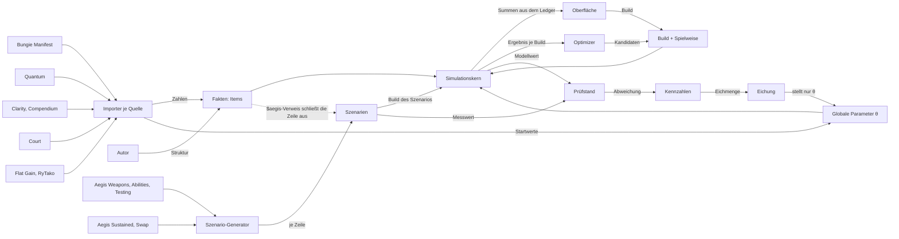
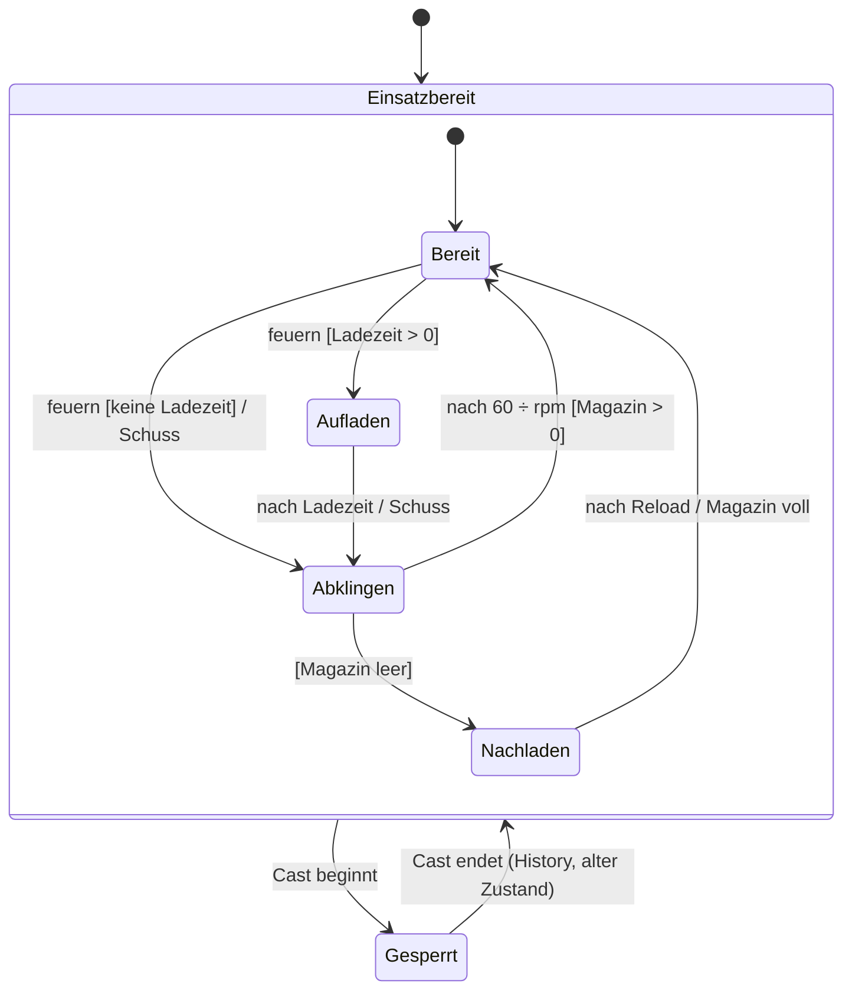
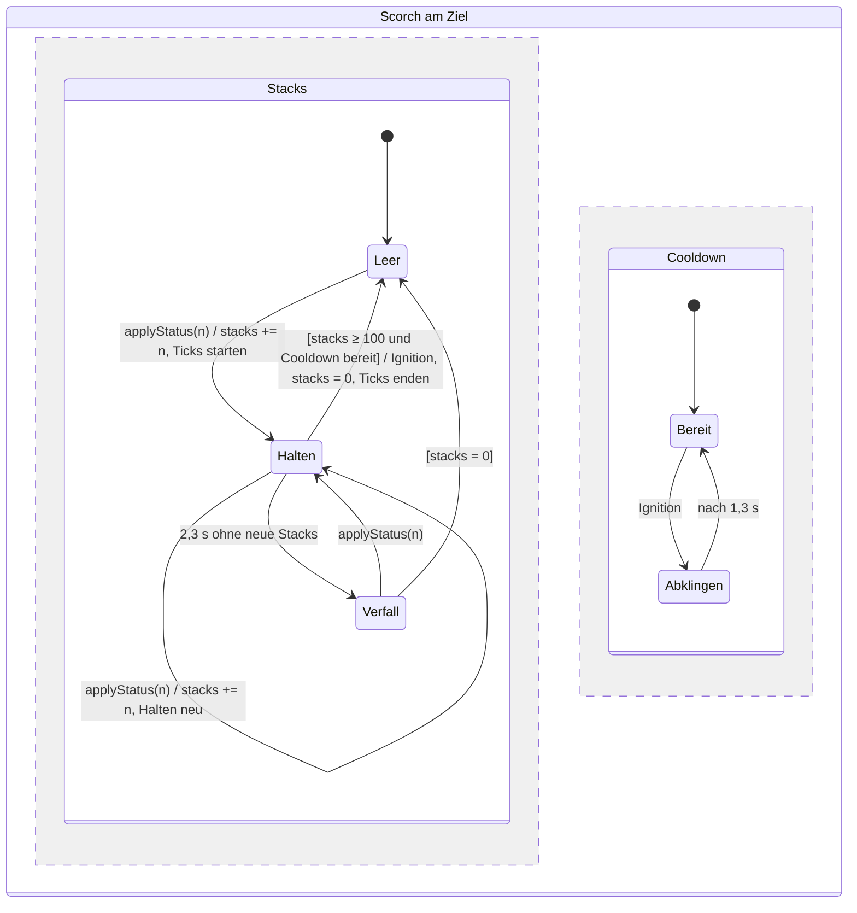
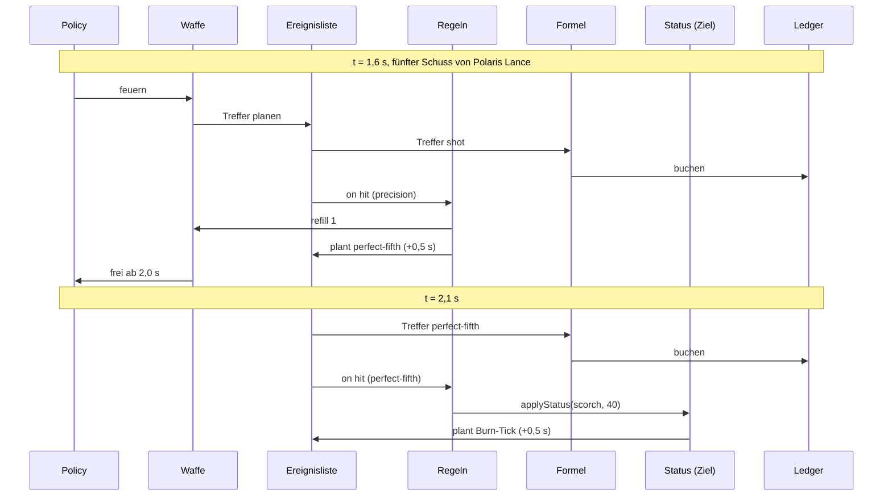
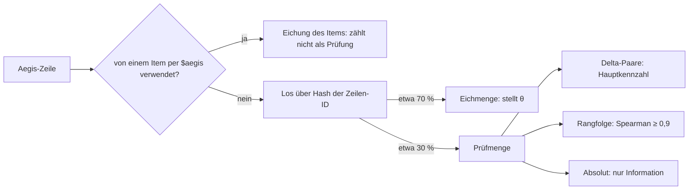

# Bauplan des Rechners

Status: angenommen vom Inhaber am 2026-10-31 (ADR 0018) · Umsetzung auf Branch `ground-up-model`, Stufen in `docs/plans/ground-up-model.md` · Ansicht mit zwölf Abbildungen: <https://claude.ai/artifact/2pmKihDrFaJvRdtDwJzBR8>

Diese Datei ist die maßgebliche, maschinenlesbare Fassung; die Ansicht folgt ihr. Lesen vor jedem Block an Engine, Daten, Import oder Prüfstand. Abschnitte tragen die Nummer der Abbildung in der Ansicht (Abb. n).

## 1 Invarianten

Jede Invariante bekommt einen Test in der Stufe, die sie einführt. Bis dahin gilt sie als Regel für neue Arbeit.

| Nr. | Invariante | Stufe, Test |
| --- | --- | --- |
| I1 | **Messung ist Prüfung, nicht Eingang.** Werte aus Aegis Weapons, Abilities oder Testing kommen nur als Verweis `$aegis[<Zeile>]` ins Modell und bekommen den Status `fitted`. Jede verwiesene Zeile zählt nicht mehr als Prüfung. | B2 (Status, Prüfstand), B4 (Resolver) |
| I2 | **Ein Weg.** Oberfläche, Optimizer und Prüfstand rufen denselben Kern über `buildSimulation(build, gameData)`; es gibt keinen zweiten Simulator. | B1 |
| I3 | **Kein Code pro Item.** Neuer Code entsteht nur für einen neuen Auslöser-, Aktions- oder Status-Typ. | B3 (Liste der Typen im Schema) |
| I4 | **Item = Datei.** Die Struktur (Takt, Teile, Regeln) steht von Hand in der Datei; jede Zahl ist ein `$`-Verweis auf eine Quelle oder ein Wert mit `source`. | B4 |
| I5 | **Text-Hash.** Jedes Item merkt sich den Hash seines Quelltexts. Ändert ein Patch den Text, bekommt das Item den Status `review` und rechnet mit der alten Struktur weiter. | B4 |
| I6 | **Kanonische Skala.** Ein Teil trägt den Schaden je Treffer gegen einen generischen Boss ohne Buffs, auf der Skala „Aegis visual“ (Wipe ÷ Full Modifiers). Jede Quelle hat je Kategorie einen Umrechnungsfaktor in θ. | B4, B5 |
| I7 | **Nichts vorab planen.** Neue Ereignisse entstehen nur an drei Stellen: im Fall `shot` (Treffer der Teile), in den Aktionen der Regeln und in der Policy. | B3 |
| I8 | **Ledger.** Jeder Treffer wird mit Zeit, Item, Teil, Grundwert und dem Faktor jedes Buckets gebucht. Summen, Donut, Breakdown, Zeitleiste und Prüfstand sind Projektionen des Ledgers. | B1 (Bestand), B3 |
| I9 | **Eichung stellt nur θ.** Ein Skript passt die globalen Parameter gegen die Eichmenge an. Ein Item wird nie an eine Zeile angepasst; seine Abweichung ist ein Befund. Abweichungen unter 2 % liegen in der Totzone und kommen nach `docs/known-inaccuracies.md`. | B5 |
| I10 | **Festes Los.** Jede nicht verwiesene Zeile fällt über einen Hash ihrer Zeilen-ID in die Eichmenge (etwa 70 %) oder die Prüfmenge (etwa 30 %). Kennzahlen kommen nur aus der Prüfmenge. | B2 |
| I11 | **Hauptkennzahl sind Delta-Paare:** zwei Zeilen, die sich in genau einem Item unterscheiden. Rangfolge (Spearman) ist zweite Kennzahl, Absolutwerte sind nur Information. | B2 |
| I12 | **Determinismus.** Gleiche Eingaben ergeben dieselbe Ereignisfolge; Gleichstände ordnet die Ereignisgruppe, dann die Reihenfolge des Planens. | B1 (Bestand) |

## 2 Datenfluss (Abb. 1)



Es gibt genau eine Rückkopplung: Kennzahlen → Eichung → θ. Keine Kante führt vom Prüfstand zu einem Item.

## 3 Was sich gegenüber heute ändert (Abb. 2)

| Heute | Ziel | Stufe |
| --- | --- | --- |
| Aegis-Zeile ist Eingang (Paket, Mittel je Schuss) und Prüfung zugleich | Aegis-Zeile ist nur Prüfung; Ausnahme `$aegis`-Verweis, dann zählt die Zeile nicht | B2, B4 |
| Annahmen der Zeile werden herausgerechnet (`fullModifiers`, `includedFactor`, Replay) | Annahmen stehen im Szenario; das Modell rechnet sie wie jeden Build | B2, Migration |
| Zwei Simulatoren (`simulate`, `simulateCore`), Parität per Test | ein Kern | B1 |
| Sonderfelder (`hitStacks`, `setup`, `holdDraw`, `refillsMagazine`, `everyNthShot`, `nthShotPart`, `playstyleParts`, `tickFactors`, `catalystWindowSeconds`, `scorchStacksPerShot`, `noReloads`) | Regeln aus etwa zehn Aktionen | B3 |
| Struktur aus Text geraten (Regelketten 1–7, F, G, H, R1–R5) plus 65 Overrides | Struktur von Hand in der Item-Datei, Zahlen per Verweis | B4, Migration |
| Skala je Fall (ADR 0011) | kanonische Skala, ein Faktor je Quelle und Kategorie | B4, B5 |
| Globale Parameter von Hand an einzelnen Zeilen gestellt | Eichung per Skript über alle Szenarien | B5 |
| Kennzahl: Szenarien innerhalb ±3 % | Delta-Paare der Prüfmenge | B2 |

## 4 Schichten und Abhängigkeiten (Abb. 3)

| Schicht | Aufgabe | liest | darf rufen |
| --- | --- | --- | --- |
| Policy | wählt die nächste Aktion: schießen, nachladen, casten | Spielweisen | Akteure |
| Akteure | Zustandsmaschinen von Waffe und Ability: Magazin, Reload, Charge, Energie | Items: Takt, Teile | Regeln |
| Regeln | Auslöser → Bedingung → Aktionen | Items: Regeln | Status |
| Status | Stacks, Dauer, Verfall, Ticks, Schwelle, Cooldown | Status-Definitionen, θ | Formel |
| Formel | Teil × Precision × Π Buckets × Stat | Buckets | – |

- Abhängigkeiten zeigen nur nach unten und von außen nach innen.
- Außen: Importer (`scripts/`) schreiben nur Zahlen in `src/data`; Treiber (Oberfläche `src/ui`, Optimizer, Prüfstand `tests/`) rufen nur den Einstieg.
- Ein neues Item ändert nur Daten. Die Struktur schreibt der Autor (Claude, der Inhaber prüft), die Zahlen der Importer.

## 5 Datenmodell

### 5.1 Drei Datenarten

| Art | Inhalt | wer schreibt | wer liest |
| --- | --- | --- | --- |
| Fakten | Items, Status-Definitionen, Buckets, θ | Autor (Struktur), Importer (Zahlen), Eichung (θ) | Kern |
| Messungen | Szenarien aus Aegis-Zeilen: Build, Spielweise, Messwert, Zeilen-ID | Szenario-Generator | Prüfstand, Eichung |
| Spielweise | Policy und Annahmen je Build oder Szenario: Precision-Anteil, Ladestufe, Rotation, Buffs vom Team | Oberfläche, Szenario | Kern (Policy) |

### 5.2 Item (Entwurf, endgültig in B4)

Gespeichert wird JSON mit Zod-Schema wie alle Data Files (ADR 0002); die Beispiele unten sind in YAML-Schreibweise der Lesbarkeit halber.

```ts
type Ref = string;                       // "$quantum.reload", "$aegis[<row>].tick(\"Perfect Fifth\")", "$theta.ignitionCooldownMs"
type Value = Ref | Sourced<number>;      // ein Wert ohne Verweis braucht source und status

interface Item {
  id: string;                            // kebab-case, Glossary-Name
  kind: "exoticWeapon" | "legendaryWeapon" | "exoticArmor" | "classItemPerk" | "aspect"
      | "fragment" | "mod" | "artifactPerk" | "buff" | "grenade" | "melee" | "classAbility" | "super";
  text?: { source: "clarity" | "compendium" | "court"; entry: string; hash: string };
  status: "ok" | "review";              // review: Quelltext hat sich geändert (I5)
  frame?: { rpm: Value; magazine: Value; reserves?: Value; reload: Value; chargeMs?: Value; ammo: "primary" | "special" | "heavy" };
  parts?: Record<string, { damage: Value; precision?: Value; delivery: "impact" | "splash" | "dot"; element?: string }>;
  rules?: Rule[];
  playstyles?: { id: string; label: string; policy: Record<string, Value | string> }[];
}

interface Rule { on: Trigger; if?: Condition[]; do: Action[]; cooldownMs?: Value }
```

### 5.3 Verweise und Status

| Verweis | Quelle | Status nach dem Auflösen |
| --- | --- | --- |
| `$manifest.<feld>` | Bungie Manifest | `verified` |
| `$quantum.<feld>` | Quantum Damage-ics | `verified` |
| `$court.<feld>` | Court's Stacking Guide | `verified` |
| `$clarity.<feld>`, `$compendium.<feld>` | Texte mit Zahlen | `derived` (Text ohne Messung) |
| `$aegis[<Zeile>].<feld>` | Aegis Weapons, Abilities, Testing | `fitted` mit Zeilen-ID; die Zeile zählt nicht (I1) |
| `$theta.<name>` | Eichung | `fitted` (Datum der Eichung) |

`Source.status` kennt heute `verified`, `unverified`, `measured`, `missing`; `fitted` kommt in B2, `derived` (heute `unverified` mit Notiz „Derived“) in B4. Ein Literal ohne Verweis braucht `source` mit Zitat wie heute in den Override-Dateien; bei unklarer Quelle `estimate` in der Notiz, nie geraten.

### 5.4 Beispiel Polaris Lance

```yaml
id: polaris-lance
kind: exoticWeapon
text: { source: clarity, entry: "The Perfect Fifth", hash: "9f3c…" }
frame: { rpm: $manifest.rpm, magazine: $manifest.magazine, reload: $quantum.reload, ammo: primary }
parts:
  shot:          { damage: $aegis[polaris-lance].crit, delivery: impact }
  perfect-fifth: { damage: $aegis[polaris-lance].tick("Perfect Fifth"), delivery: splash }
rules:
  - on: hit { part: shot, precision: true }
    do: [ refill { ammo: 1 } ]
  - on: hit { part: shot, precision: true }
    if: [ counter fifth < 4 ]
    do: [ addStacks { counter: fifth } ]
  - on: hit { part: shot, precision: true }
    if: [ counter fifth = 4 ]
    do: [ resetCounter { counter: fifth }, spawn { part: perfect-fifth, afterMs: { value: 500, note: "Clarity ?", status: estimate } } ]
  - on: hit { part: perfect-fifth }
    do: [ applyStatus { status: scorch, stacks: $clarity.scorch } ]   # 40, mit Ember of Ashes 60
```

## 6 Regeln: Auslöser, Bedingungen, Aktionen

Muster Event – Condition – Action (Dayal u. a. 1988). Bedingungen werden vor den Aktionen derselben Regel ausgewertet; Regeln eines Ereignisses laufen in Dateireihenfolge.

| Auslöser | Felder |
| --- | --- |
| `shot` | Item, Teil |
| `hit` | Item, Teil, `precision`, Filter (Waffentyp, Element, Damage Source, Keyword) |
| `cast` | Ability-Art, Ability |
| `reload` | Beginn oder Ende |
| `status` | Status, Schwelle erreicht |
| `timer` | Ablauf eines Buffs, Fensters oder Cooldowns |
| `phaseStart` | Beginn der Damage Phase (vorher aufgebaute Effekte) |

Bedingungen: Zählerstand, Stacks eines Status, Buff aktiv, Zustand eines Akteurs (`in(Bereit)`), Spielweise, Build enthält Item.

| Aktion | Wirkung | Beispiele (heute Sonderfeld) |
| --- | --- | --- |
| `spawn` | plant Treffer eines Teils, mit Verzögerung und Anzahl | Perfect Fifth, Wolfpack Rounds, Seeker (`everyNthShot`, `nthShotPart`) |
| `addStacks`, `resetCounter` | Zähler oder Buff-Stapel ändern | Perfect-Fifth-Zähler, Peacekeepers (`hitStacks`) |
| `applyStatus` | Status am Ziel | Scorch, Volatile, Jolt, Weaken (`scorchStacksPerShot`) |
| `grantBuff` | Buff am Spieler, genau ein Bucket, Dauer | Radiant, Reaper's Tithe (`catalystWindowSeconds`) |
| `refill` | Magazin auffüllen | Polaris Lance, Marksman's Dodge (`refillsMagazine`, `noReloads`) |
| `modifyStat` | Takt, Reload, Ladezeit für eine Dauer | Archer's Tempo, Reload-Catalysts, gehaltener Zug (`holdDraw`) |
| `setMode` | Feuermodus, Ladestufe, Aufbau | Whirling Ovation, Guidance Ring (`playstyleParts`, `setup`) |
| `addResource` | Energie oder Ladung | Ability-Energie, Golden-Gun-Ladung |
| `modifyAction` | ändert die Aktion eines anderen Items | Ember of Ashes (Scorch), Dawn Chorus (Ignition ×2) |
| `damage` | eigener Schaden ohne Waffenteil | Storm's Keep, Hellion (`periodicDamage`) |

Die Liste ist der Entwurf aus ADR 0017, ergänzt um die heutigen Sonderfelder; endgültig in B3.

## 7 Kern: Ereignisschleife (Abb. 5)

Diskrete Ereignissimulation (DEVS, Zeigler 1976): Zeitsprung von Ereignis zu Ereignis.

```text
simulate(build, facts, playstyle, T) -> Ledger
  Akteure, Status und Regeln aus Build und Fakten aufbauen; Ledger leer
  Ereignisliste <- Policy.ersteAktionen(t = 0)
  solange ein Ereignis e mit e.t <= T in der Ereignisliste steht:
    e <- frühestes Ereignis entnehmen; t <- e.t
    Fall e.art:
      shot:  Magazin - 1; Treffer jedes Teils planen (Verzögerung, Anzahl)
      hit:   Schaden <- Formel(Teil, aktive Faktoren); Ledger.buchen
      tick:  Burn <- Formel(Stacks); Ledger.buchen; nächsten Tick planen
      cast:  Treffer und Buffs der Ability planen; Waffe -> Gesperrt
      timer: Reload fertig, Cast vorbei, Buff abgelaufen: Zustand setzen
    für jede Regel r, deren Auslöser zu e passt:
      falls r.if erfüllt: r.do ausführen (Stacks, Status, Buffs ändern; Ereignisse planen)
    falls ein Akteur frei ist und nichts geplant hat:
      Ereignisliste <- Policy.nächsteAktion(t, Zustand)
  Ergebnis <- Summen über den Ledger: gesamt, je Quelle, je Bucket, als Zeitreihe
```

Heute: `src/engine/simulate.ts` (Einstieg), `core/simulateCore.ts`, `weaponActor.ts`, `context.ts`, `burn.ts`, `formula.ts`, `types.ts`, `castEvents.ts`; der alte Simulator ist seit B1 entfernt. Casts, Fenster und periodischer Schaden sind dort noch vorab geplant; das bleibt bis zur Strategie-Stufe.

## 8 Automaten (Abb. 6, 7)

Schreibweise `Ereignis [Bedingung] / Aktion` (Harel 1987).



Die Waffe kennt keine Perks; `refill`, `modifyStat` und `setMode` wirken von außen. Nach einem Cast geht es im alten Zustand weiter, außer eine Regel ändert ihn (Marksman's Dodge lädt nach).



Werte aus `src/data/keywords.json`: Schwelle 100, Cooldown 1300 ms, Burn je Tick 2,7 + 0,175 × Stacks (× Faktoren der letzten Quelle), erster Tick 500 ms nach den ersten Stacks, zweiter 930 ms danach, dann alle 560 ms, Halten 2300 ms, Verfall ein Stack je 40 ms. Volatile, Jolt und Unravel sind derselbe Automat mit eigenen Werten.

## 9 Ein Treffer (Abb. 8)



Die Formel kennt kein Item, die Regeln kennen keinen Schaden, der Ledger bucht nur.

## 10 Formel und Buckets (Abb. 9)

Treffer = d × p × Π Buckets × s. d: Teilwert (kanonische Skala), p: Precision, s: Stat-Faktor (Ability-Stat, Weapons-Stat). Ein Buff zählt nur, wenn sein Filter zum Treffer passt, und landet in genau einem Bucket. Innerhalb eines Buckets gilt seine Regel, zwischen Buckets das Produkt.

| Bucket (`buckets.json`) | innerhalb | Beispiele | Status |
| --- | --- | --- | --- |
| `empowering` | höchster | Radiant, Well of Radiance | verified |
| `debuff` | höchster (Ausnahmen überschreiben, `docs/mechanics/damage-stacking.md`) | Weaken, Divinity | verified |
| `surge` | höchster | Surge-Mods | verified |
| `amplification` | Produkt | Argent Ordnance, Argent Blade | verified |
| `weaponPerk` | Produkt | Perks der Waffe | verified |
| `exoticIntrinsic` | Produkt | Intrinsics der Exotics | verified |
| `melee` | 1 + Summe | Knockout, Banner of War | verified |
| `transcendence` | Produkt | Transcendence | verified |
| `aspectBonus` | Produkt | Roaring Flames, Facet of Courage | unverified (Annahme) |
| `abilityStat` | (nur einer je Ability) | Super-, Grenade-, Melee-Stat | unverified |

## 11 Golden-Beispiel Polaris Lance (Abb. 10)

Akzeptanztest für B3 (Regeln im Kern). Annahmen: nur Präzisionstreffer, 150 rpm (Schuss alle 0,4 s ab 0 s), kein Reload, Perfect Fifth auf jedem 5. Schuss, 0,5 s Verzögerung, Werte aus Abschnitt 8. Phase T = 10,5 s.

| Größe | ohne Ember (x40) | mit Ember of Ashes (x60) |
| --- | --- | --- |
| Perfect Fifths (Explosion bei) | 2,1 · 4,1 · 6,1 · 8,1 · 10,1 s | gleich |
| Stacks nach jeder Explosion | 40 · 80 · 120 → Ignition · 40 · 80 | 60 · 120 → Ignition · 60 · 120 → Ignition · 60 |
| Ignitions | 1 (6,1 s) | 2 (4,1 s, 8,1 s) |
| Burn-Ticks | 9 (2,6 · 3,53 · 4,09 · 4,65 · 5,21 · 5,77 · 8,6 · 9,53 · 10,09 s) | 6 (2,6 · 3,53 · 4,09 · 6,6 · 7,53 · 8,09 s) |
| über 30 s (heutiges Gate) | 14 Perfect Fifths, 4 Ignitions | 14, 7 |

Die Zeilen bis 10,5 s sind aus diesem Bauplan gerechnet und gegen den heutigen Kern noch ungeprüft; die 30-s-Zeile ist das bestehende Gate (`tests/everyNthShot.test.ts`, `plausibility`). Ember ändert nur eine Zahl; dass jede zweite statt jede dritte Perfect Fifth zündet, folgt aus dem Modell.

## 12 Prüfen und Eichen (Abb. 11, 12)



- Los: fester Hash der Zeilen-ID (Vorschlag FNV-1a, Rest mod 10 < 7 → Eichmenge), damit neue Zeilen die Aufteilung der alten nicht verschieben. Sustained und Swap rechnet Aegis selbst; sie gehen nur in die Rangfolge.
- Delta-Paar besteht, wenn |Δ Modell − Δ Aegis| ≤ 2 Prozentpunkte (wie im Rangfolge-Gate).
- Szenarien entstehen aus jeder Zeile, deren Annahmen alle einen Schalter haben (Zuordnung aus `scripts/lib/probeAuto.ts` und `weaponAssumptions.ts`); Zeilen mit fehlendem Schalter stehen mit dem Schalter auf einer Liste.

Regelkreis der Eichung (Wirkungsplan nach DIN IEC 60050-351):

| Glied | Hier |
| --- | --- |
| Sollwert w | Messwerte der Eichmenge |
| Istwert x | Modellwerte derselben Szenarien |
| Regelabweichung e | log(x ÷ w) je Szenario |
| Totzone | ±2 %: kleinere Abweichungen kommen nach `docs/known-inaccuracies.md` |
| Regler | Skript, kleinste Quadrate über alle Szenarien zugleich, einmal je Patch (`npm run calibrate`, B5) |
| Stellgröße | nur θ: Ignition-Cooldown, Burn-Formel, Skala je Quelle und Kategorie; mit Grenzen aus den Quellen |
| Regelstrecke | Kern + Items (fest) |
| Störgrößen | Messstreuung („average“), Patch |
| verboten | jede Kante vom Regler zu einem Item |

## 13 Offen bis zur Stufe

- Dateiformat und Ordner der Items (B4), endgültige Aktionsliste (B3), Hash und Anteil des Loses (B2), Grenzen von θ (B5).
- Quelle der Waffen-Grundwerte (B4): Quantum hält die Aegis-Zeilen als Prüfung frei, `$aegis` ist aktueller, macht die Zeile aber zur Eichung. Entscheidung an Zahlen (wie viele Delta-Paare bleiben, wie weit Quantum und Aegis auseinanderliegen); bis dahin „Aegis vor Quantum“.
- Policy für Casts und Energie im Lauf: erst mit dem Optimizer für Abilities (2.0).

## Methoden

DeMarco 1978 (Datenflussplan), Cockburn 2005 und Brown (Ports and Adapters, C4), W3C PROV-DM 2013 (Herkunft), Nassi und Shneiderman 1973, DIN 66261 (Struktogramm), Zeigler 1976 (DEVS), Harel 1987 (Statecharts), Dayal u. a. 1988 (ECA-Regeln), OMG UML 2.5.1 (Sequenz, Zeitverlauf), Mason 1953 (Signalflussgraph), Fowler 2005 (Event Sourcing), Stone 1974 (Hold-out), Spearman 1904 (Rangkorrelation), DIN IEC 60050-351 (Regelkreis).
